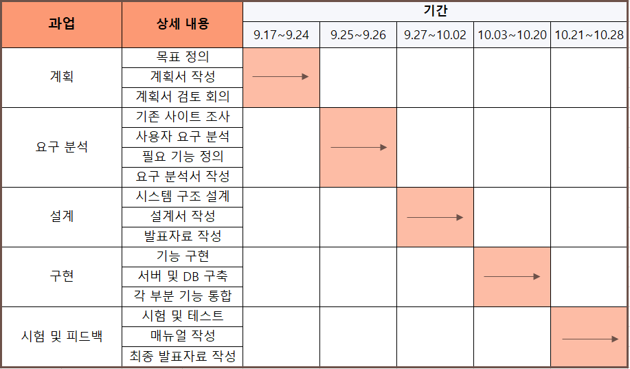
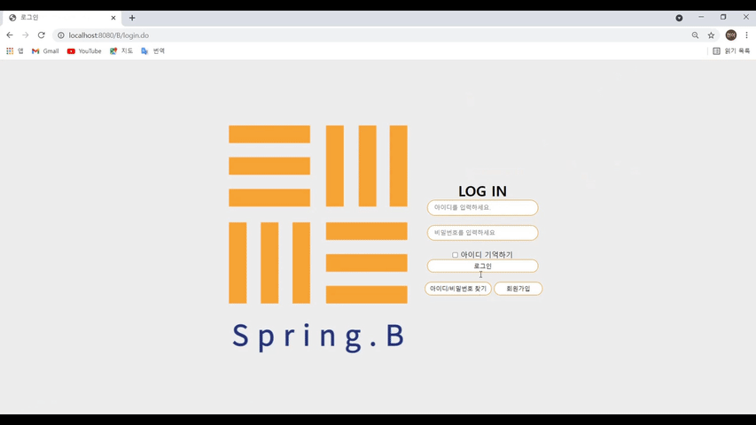
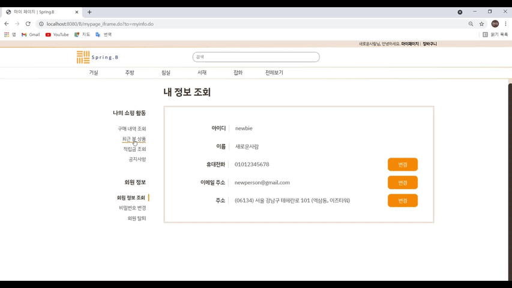
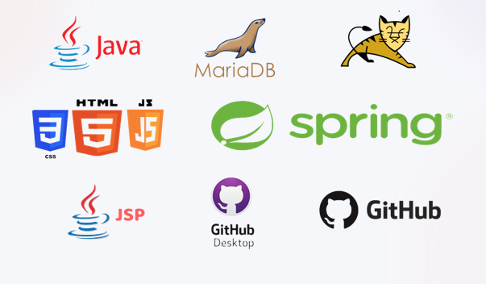

# Spring Project TeamB

## 📌 프로젝트 소개

비대면 소비 증가와 간편 결제 서비스 확산에 따라,
온라인으로 가구를 구매하는 트렌드를 반영하여 제작된 **온라인 가구 쇼핑몰 프로젝트**입니다.

사용자가 상품을 탐색하고 장바구니, 결제까지 이어지는 쇼핑 프로세스를 구현하였으며,
관리자 페이지를 통해 주문 및 상품을 관리할 수 있도록 설계되었습니다.

## 🛠 기술 스택

* Java
* Spring Framework (MVC)
* JSP / Servlet
* MyBatis
* Oracle Database
* Apache Tomcat
* HTML / CSS / JavaScript
  
<h2>🔍프로젝트 개요</h2>

- 프로젝트 일정
- 프로젝트 소개
- Tech Stack
- ERD
- Tips
  
## 🤼‍♂️ 팀원 구성

* Team Leader : 이현아
* Frontend : 강재하, 이윤지, 박진원
* Backend : 정원우, 권오선

## 🔧 주요 기능

### 🧑 사용자 기능

* 회원가입 및 로그인 (세션 기반 인증)
* 상품 검색 및 상세 페이지 조회
* 장바구니 및 결제 기능
* 최근 본 상품 및 교환 신청 기능

### 🛠 관리자 기능

* 주문 관리
* 고객 관리
* 상품 등록 및 관리
* 사이트 로그 관리
 
<h3 id="b1">- 프로젝트 일정</h3>
 

## 🖼 주요 화면

<h4>1. 로그인</h4>
 

<h4>2. 메인 > 장바구니 > 결제</h4>
 
<h4>3. 관리자 > 주문관리 > 고객관리 > 사이트관리(로그기록) > 상품관리(등록)</h4>
 
<h4>4. 최근 본 상품 > 교환신청</h4>
 
<h4>5. 재고별 상세페이지 표현 > 바로구매</h4>
 
<h4>6. 상품 검색</h4>

  
<h3 id="b3">🔧Tech Stack</h3>

  

<h3 id="b4">✏️ERD</h3>

  

## 💡 참고 및 사용 기술

- 기존에 쓰고 있던 DB를 다른 DB로 옮기는 방법

  

- 채팅 위젯 tawk

- 사진 클라우드 사이트 'Blogger'

- 컬러 조합 사이트

  

